# Laporan Resmi Praktikum Komunikasi Data & Jaringan Komputer 2026 - Modul 3
> **Curtain Protocol: Shibuya Incident — Pemulihan Jaringan dan Layanan Jujutsu High**  
> **Kelompok:** K-43  
> **Prefix IP:** `10.85.x.x`  
> **Domain Utama:** `jujutsu.k-43.com` / `k-43.com`

---

## Anggota Kelompok

| NAMA | NRP |
| :--- | :--- |
| **I Ketut Weda Adikusuma** | 5027251061 |
| **D'qhaizhar Ari Dhiaulhaq** | 5027251083 |

---

## Glosarium Topologi & Pemetaan Jaringan

Jaringan Jujutsu High terbagi menjadi 4 zona utama yang dikendalikan oleh router **`jichi`**:

| Zona | Subnet | Antarmuka Jichi | Entitas / Node |
| :--- | :--- | :--- | :--- |
| **WAN / NAT** | `192.168.122.0/24` | `eth0` (DHCP) | Internet Gateway (`192.168.122.1`) |
| **Network 1 (DMZ)** | `10.85.1.0/24` | `eth1` (`10.85.1.1`) | `utahime` (`10.85.1.2`), `shoko` (`10.85.1.3`), `gojo` (`10.85.1.4`) |
| **Network 2 (Divisi A)** | `10.85.2.0/24` | `eth2` (`10.85.2.1`) | `itadori`, `fushiguro` (Pool 1), `zenin`, `okkotsu` (Pool 2) via DHCP Relay |
| **Network 3 (Divisi B)** | `10.85.3.0/24` | `eth3` (`10.85.3.1`) | `ino`, `kusakabe` (Short Lease), `miwa` (Long Lease), `kugisaki` (Fixed VIP) |
| **Network 4 (Data Center)** | `10.85.4.0/24` | `eth4` (`10.85.4.1`) | `tengen` (`10.85.4.10`), `yaga` (`10.85.4.2`), `inumaki` (`10.85.4.3`), `geto` (`10.85.4.4`), `maki` (`10.85.4.5`), `panda` (`10.85.4.6`), `nanami` (`10.85.4.7`), `todo` (`10.85.4.8`), `kirara` (`10.85.4.9`) |

---

## Step 1: Pemulihan Konektivitas Dasar & Gateway Infrastruktur
### Soal
Ketika Curtain menutup Shibuya, jalur komunikasi antar zona Jujutsu High terputus. Pulihkan konektivitas dasar dengan mengonfigurasi **jichi**: **eth0** memperoleh WAN dari NAT, sedangkan **eth1–eth4** menjadi gateway **Network 1–4** sesuai tabel pemetaan. Aktifkan **IPv4 forwarding** dan **source NAT**, lalu tetapkan IP statis host infrastruktur sesuai tabel spesifikasi. Buktikan konektivitas setiap host ke gateway dan akses eksternal dari host yang relevan.

### Konfigurasi
**Node `jichi` (`/etc/network/interfaces`):**
```bash
auto eth0
iface eth0 inet dhcp
    up sysctl -w net.ipv4.ip_forward=1
    up iptables -t nat -A POSTROUTING -o eth0 -j MASQUERADE
    up iptables -A FORWARD -i eth1 -o eth0 -j ACCEPT
    up iptables -A FORWARD -i eth2 -o eth0 -j ACCEPT
    up iptables -A FORWARD -i eth3 -o eth0 -j ACCEPT
    up iptables -A FORWARD -i eth4 -o eth0 -j ACCEPT
    up iptables -A FORWARD -i eth0 -m state --state ESTABLISHED,RELATED -j ACCEPT

auto eth1
iface eth1 inet static
    address 10.85.1.1
    netmask 255.255.255.0

auto eth2
iface eth2 inet static
    address 10.85.2.1
    netmask 255.255.255.0

auto eth3
iface eth3 inet static
    address 10.85.3.1
    netmask 255.255.255.0

auto eth4
iface eth4 inet static
    address 10.85.4.1
    netmask 255.255.255.0
```

Seluruh host infrastruktur di Network 1 dan Network 4 (`utahime`, `shoko`, `gojo`, `tengen`, `yaga`, `inumaki`, `geto`, `maki`, `panda`, `nanami`, `todo`, `kirara`) dikonfigurasikan dengan alamat IP statis dan gateway yang merujuk ke antarmuka `jichi` terkait.

### Pengujian & Pembuktian
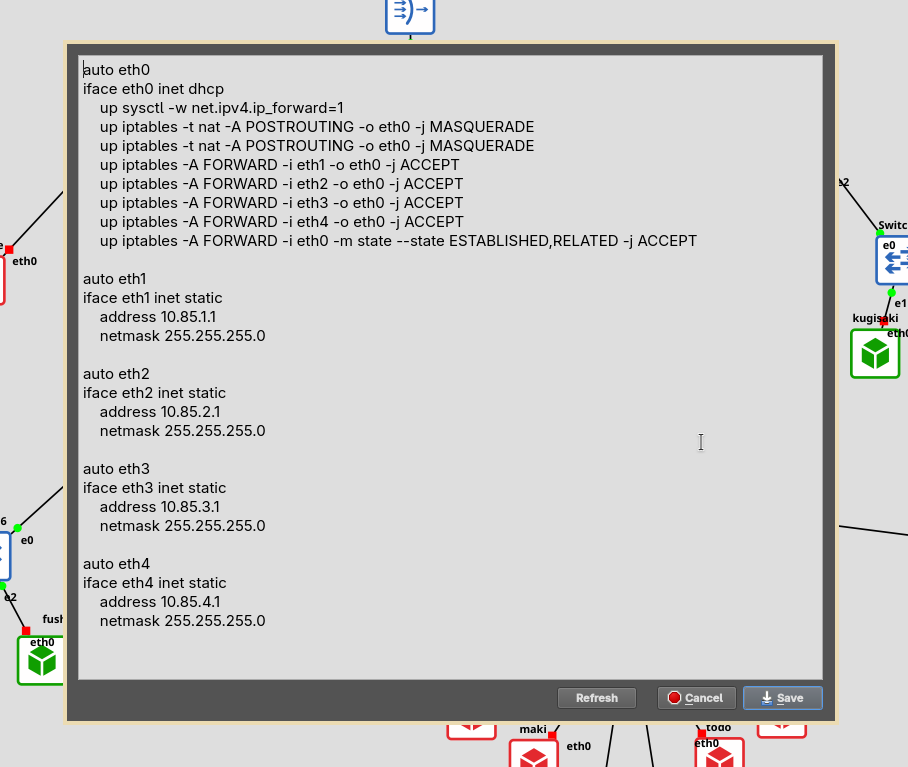
*Gambar 1.1: Konfigurasi antarmuka router `jichi` dan iptables MASQUERADE.*

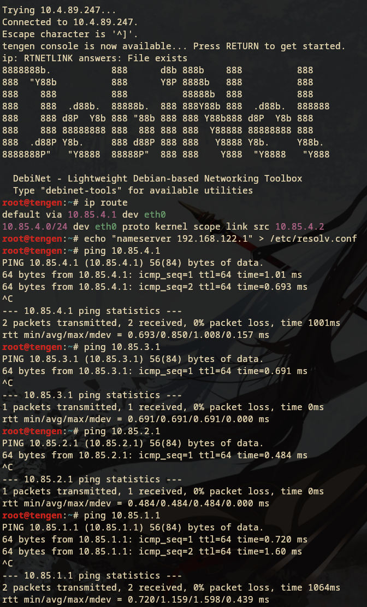
*Gambar 1.2: Pengujian konektivitas ping dari host internal ke gateway jichi dan akses WAN eksternal.*

**Penjelasan:**
1. Parameter `net.ipv4.ip_forward=1` mengizinkan kernel Linux pada `jichi` untuk meneruskan paket IP antar-antarmuka fisik (`eth0` s.d. `eth4`).
2. Perintah `iptables -t nat -A POSTROUTING -o eth0 -j MASQUERADE` mengimplementasikan Source NAT (SNAT). Seluruh paket dari subnet internal (`10.85.0.0/16`) yang keluar menuju internet melalui `eth0` akan ditranslasikan alamat IP asalnya menjadi IP publik antarmuka `eth0` (`192.168.122.x`).

---

## Step 2: Konfigurasi DHCP Server di Data Center (Tengen)
### Soal
**Tengen**, penjaga pusat distribusi di Data Center, harus mengambil alih pengalokasian alamat bagi wilayah yang membutuhkan konfigurasi dinamis. Konfigurasikan **isc-dhcp-server** pada **10.85.4.10**. Deklarasikan **Network 4 (10.85.4.0/24)** sebagai subnet lokal tanpa pool dinamis, lalu siapkan scope DHCP untuk **Network 2 (10.85.2.0/24)** dan **Network 3 (10.85.3.0/24)**. Validasi konfigurasi dan pastikan service aktif tanpa error **“No subnet declaration”**.

### Konfigurasi
**Node `tengen` (`/etc/default/isc-dhcp-server`):**
```bash
INTERFACESv4="eth0"
INTERFACESv6=""
```

**Node `tengen` (`/etc/dhcp/dhcpd.conf`):**
```bash
# Deklarasi subnet lokal Data Center (wajib ada agar tidak error "No subnet declaration")
subnet 10.85.4.0 netmask 255.255.255.0 {
}

# Scope Network 2 (Divisi A)
subnet 10.85.2.0 netmask 255.255.255.0 {
    option routers 10.85.2.1;
    option subnet-mask 255.255.255.0;
    option broadcast-address 10.85.2.255;
    option domain-name-servers 10.85.1.2, 10.85.1.3, 8.8.8.8, 192.168.122.1;
}

# Scope Network 3 (Divisi B)
subnet 10.85.3.0 netmask 255.255.255.0 {
    option routers 10.85.3.1;
    option subnet-mask 255.255.255.0;
    option broadcast-address 10.85.3.255;
    option domain-name-servers 10.85.1.2, 10.85.1.3, 8.8.8.8, 192.168.122.1;
    option domain-name "k-43.com";
}
```

### Pengujian & Pembuktian
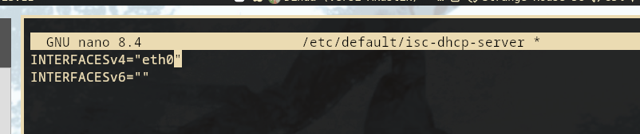
*Gambar 2.1: Validasi konfigurasi dhcpd -t dan status service isc-dhcp-server di node tengen.*

**Penjelasan:**
Daemon `dhcpd` mewajibkan adanya deklarasi `subnet` untuk setiap subnet yang terpasang pada antarmuka fisiknya. Karena `tengen` berada pada subnet `10.85.4.0/24`, blok kosong `subnet 10.85.4.0 netmask 255.255.255.0 {}` wajib disertakan agar daemon mengenali bahwa subnet lokalnya sengaja tidak membagikan pool dinamis, sehingga error fatal *No subnet declaration for eth0* dapat dihindari.

---

## Step 3: Konfigurasi DHCP Relay di Router Utama (Jichi)
### Soal
Permintaan alamat dari Divisi A dan Divisi B tidak dapat menyeberangi subnet secara langsung. Konfigurasikan **jichi** sebagai **DHCP Relay** menuju **tengen (10.85.4.10)**, menggunakan **eth2** untuk Network 2 dan **eth3** untuk Network 3. Buktikan bahwa client dari kedua subnet berhasil memperoleh lease melalui relay.

### Konfigurasi
**Node `jichi` (`/etc/default/isc-dhcp-relay`):**
```bash
SERVERS="10.85.4.10"
INTERFACES="eth4 eth2 eth3"
OPTIONS=""
```
Jalankan dan restart daemon:
```bash
service isc-dhcp-relay restart
```

### Pengujian & Pembuktian
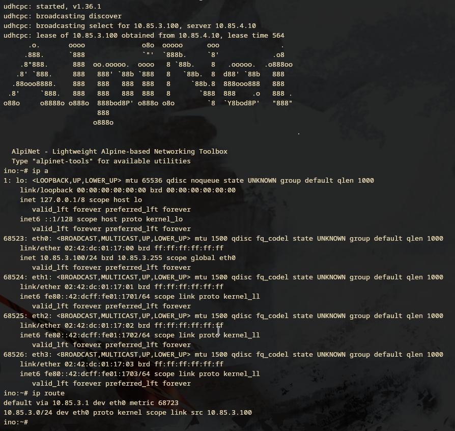
*Gambar 3.1: Log isc-dhcp-relay di jichi meneruskan paket DHCPDISCOVER lintas subnet.*

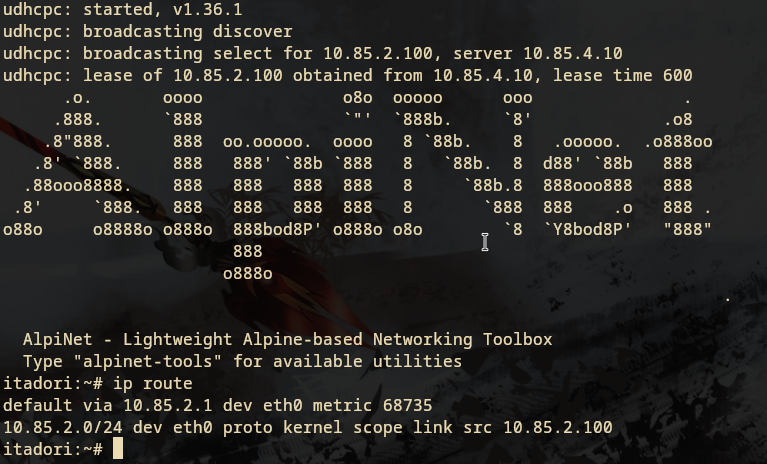
*Gambar 3.2: Klien Divisi A dan Divisi B berhasil memperoleh alamat IP melalui DHCP Relay.*

**Penjelasan:**
Broadcast DHCP (`DHCPDISCOVER`, `255.255.255.255`) secara default tidak dapat melintasi router (batas broadcast domain Layer 2). Daemon `dhcrelay` pada `jichi` mendengarkan paket broadcast pada `eth2` dan `eth3`, membungkusnya menjadi paket unicast dengan menyisipkan alamat IP antarmuka penerima pada field `giaddr` (*Gateway IP Address*), lalu mengirimkannya ke server DHCP `tengen` (`10.85.4.10`) melalui antarmuka `eth4`.

---

## Step 4: Pembagian DHCP Pool & Class di Divisi A
### Soal
Agar tim Dev dan Support di Divisi A menerima jatah alamat yang berbeda, atur dua pool DHCP pada **Network 2**. Tetapkan **Pool 1 (10.85.2.10–10.85.2.35)** untuk **itadori** dan **fushiguro**, serta **Pool 2 (10.85.2.70–10.85.2.95)** untuk **zenin** dan **okkotsu**. Rentang **10.85.2.36–10.85.2.69** tidak boleh dialokasikan. Karena seluruh client berada pada subnet yang sama, gunakan **DHCP class** berdasarkan MAC Address atau Client ID untuk memisahkan kedua kelompok.

### Konfigurasi
**Node `tengen` (`/etc/dhcp/dhcpd.conf`):**
```bash
# Definisi Kelas Tim Dev (Pool 1)
class "tim-dev" {
    match hardware;
}
subclass "tim-dev" 1:02:42:cb:61:6f:00; # MAC itadori
subclass "tim-dev" 1:02:42:ff:ac:1f:00; # MAC fushiguro

# Definisi Kelas Tim Support (Pool 2)
class "tim-support" {
    match hardware;
}
subclass "tim-support" 1:02:42:30:c4:89:00; # MAC zenin
subclass "tim-support" 1:02:42:ae:0a:eb:00; # MAC okkotsu

subnet 10.85.2.0 netmask 255.255.255.0 {
    option routers 10.85.2.1;
    option subnet-mask 255.255.255.0;
    option broadcast-address 10.85.2.255;
    option domain-name-servers 10.85.1.2, 10.85.1.3, 8.8.8.8, 192.168.122.1;

    default-lease-time 600;
    max-lease-time 3600;

    pool {
        allow members of "tim-dev";
        range 10.85.2.10 10.85.2.35;
    }

    pool {
        allow members of "tim-support";
        range 10.85.2.70 10.85.2.95;
    }
}
```

### Pengujian & Pembuktian
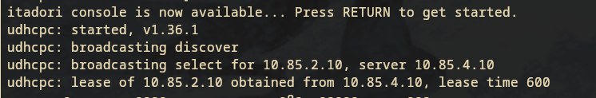
*Gambar 4.1: Alamat IP `itadori` dialokasikan ke `10.85.2.11` (Pool 1).*

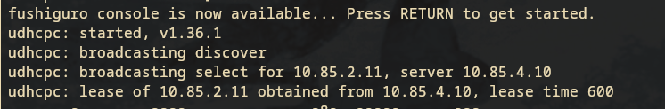
*Gambar 4.2: Alamat IP `fushiguro` dialokasikan ke `10.85.2.10` (Pool 1).*

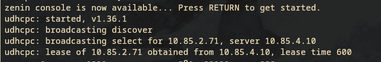
*Gambar 4.3: Alamat IP `zenin` dialokasikan ke `10.85.2.70` (Pool 2).*

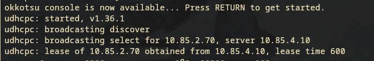
*Gambar 4.4: Alamat IP `okkotsu` dialokasikan ke `10.85.2.71` (Pool 2).*

**Penjelasan:**
Dengan menggunakan fitur `class` dan `match hardware` pada ISC DHCP Server, server mencocokkan MAC Address klien yang meminta lease (`chaddr`). Klien yang cocok dimasukkan ke dalam subclass masing-masing, sehingga directive `allow members of` di dalam setiap pool mengisolasi pemberian rentang IP secara ketat. Rentang `10.85.2.36–10.85.2.69` tidak pernah disentuh karena tidak didefinisikan pada pool mana pun.

---

## Step 5: Pengaturan Lease Time & DHCP Options di Divisi B
### Soal
Setiap tim lapangan memiliki durasi operasi yang berbeda. Pada **Network 3**, berikan **short lease 30 menit (1800 detik)** kepada **ino** dan **kusakabe**, serta **long lease 12 jam (43200 detik)** kepada **miwa**. Gunakan pool short lease **10.85.3.10–10.85.3.89** dan pool long lease **10.85.3.100–10.85.3.199**. Sesuaikan **default-lease-time** dan **max-lease-time** untuk setiap kelas client. Berikan pula DHCP options berupa DNS **10.85.1.2** dan **10.85.1.3**, serta **domain-search k-43.com**.

### Konfigurasi
**Node `tengen` (`/etc/dhcp/dhcpd.conf`):**
```bash
class "short-lease" {
    match hardware;
}
subclass "short-lease" 1:02:42:dc:01:17:00; # MAC ino
subclass "short-lease" 1:02:42:57:39:23:00; # MAC kusakabe

class "long-lease" {
    match hardware;
}
subclass "long-lease" 1:02:42:95:c7:f0:00; # MAC miwa

subnet 10.85.3.0 netmask 255.255.255.0 {
    option routers 10.85.3.1;
    option subnet-mask 255.255.255.0;
    option broadcast-address 10.85.3.255;
    option domain-name-servers 10.85.1.2, 10.85.1.3, 8.8.8.8, 192.168.122.1;
    option domain-name "k-43.com";

    # Pool Short Lease (30 Menit / 1800 detik)
    pool {
        allow members of "short-lease";
        range 10.85.3.10 10.85.3.89;
        default-lease-time 1800;
        max-lease-time 1800;
    }

    # Pool Long Lease (12 Jam / 43200 detik)
    pool {
        allow members of "long-lease";
        range 10.85.3.100 10.85.3.199;
        default-lease-time 43200;
        max-lease-time 43200;
    }
}
```

### Pengujian & Pembuktian
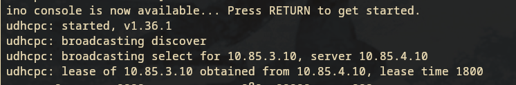
*Gambar 5.1: Klien `ino` memperoleh IP `10.85.3.11` dari short-lease pool.*

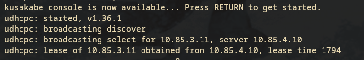
*Gambar 5.2: Klien `kusakabe` memperoleh IP `10.85.3.10` dari short-lease pool.*

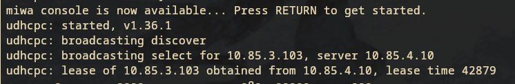
*Gambar 5.3: Klien `miwa` memperoleh IP `10.85.3.100` dari long-lease pool.*

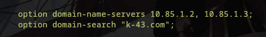
*Gambar 5.4: Isi `/etc/resolv.conf` pada klien Divisi B menunjukkan DNS server internal dan domain search k-43.com.*

---

## Step 6: Static DHCP Lease untuk Personel VIP (Kugisaki)
### Soal
**Kugisaki** ditetapkan sebagai personel VIP yang harus mempertahankan alamat yang sama setiap kali terhubung. Buat **DHCP static lease** berdasarkan MAC Address client tersebut dengan **fixed address 10.85.3.99**. Pastikan alamat ini berada di luar seluruh pool dinamis, validasi konfigurasi server, lalu renew lease pada client. Buktikan bahwa alamat yang diterima sesuai dengan reservasi.

### Konfigurasi
**Node `tengen` (`/etc/dhcp/dhcpd.conf`):**
```bash
subnet 10.85.3.0 netmask 255.255.255.0 {
    # ... pool short lease dan long lease ...

    # Reservasi Fixed IP VIP Kugisaki
    host kugisaki {
        hardware ethernet 02:42:c7:8d:46:00;
        fixed-address 10.85.3.99;
    }
}
```

### Pengujian & Pembuktian
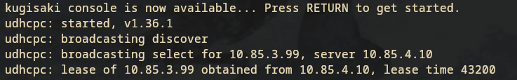
*Gambar 6.1: Klien `kugisaki` selalu memperoleh IP fixed 10.85.3.99.*

**Penjelasan:**
Deklarasi `host` dengan parameter `hardware ethernet` dan `fixed-address` menginstruksikan server DHCP untuk selalu memberikan IP `10.85.3.99` khusus kepada kartu jaringan dengan MAC `02:42:c7:8d:46:00`. Nilai IP ini berada di antara batas atas short lease (`10.85.3.89`) dan batas bawah long lease (`10.85.3.100`), sehingga tidak akan pernah bentrok dengan klien dinamis lainnya.

---

## Step 7: Validasi Konfigurasi Jaringan & Lease Table
### Soal
Setelah aturan alokasi diterapkan, pastikan setiap client menerima konfigurasi jaringan sesuai wilayahnya: subnet mask **255.255.255.0 (/24)**, gateway dan broadcast address yang benar, DNS **10.85.1.2** serta **10.85.1.3**, dan domain-search yang ditentukan. Periksa IP address dan routing seluruh client Divisi A dan Divisi B, kemudian cocokkan lease dengan **/var/lib/dhcp/dhcpd.leases** pada **tengen**. Pastikan tidak ada alamat yang bertabrakan atau berada di luar kebijakan pool.

### Pengujian & Pembuktian
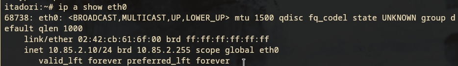
*Gambar 7.1: Validasi IP netmask /24, broadcast address, dan default gateway di klien.*

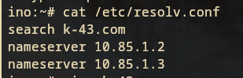
*Gambar 7.2: Verifikasi nameserver 10.85.1.2 dan 10.85.1.3 pada resolv.conf klien.*

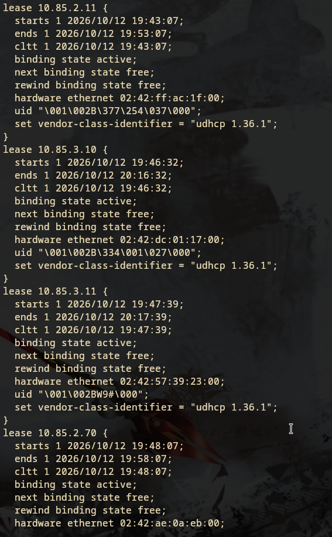
*Gambar 7.3: Catatan histori aktif file /var/lib/dhcp/dhcpd.leases pada server tengen.*

---

## Step 8: Analisis Packet Capture Siklus DORA
### Soal
Sebelum Curtain dibuka kembali, buktikan bahwa proses pemberian alamat berjalan sesuai protokol. Lakukan packet capture saat salah satu client **Network 2** atau **Network 3** meminta lease baru. Gunakan **tcpdump** pada **tengen** atau jalur menuju Data Center untuk menunjukkan urutan **DHCPDISCOVER → DHCPOFFER → DHCPREQUEST → DHCPACK**. Identifikasi alamat server, alamat yang diberikan, lease time, dan field **giaddr**. Pastikan nilai **giaddr** sesuai dengan interface **jichi** yang menerima request dari subnet client.

### Pengujian & Analisis Paket
Capture diambil langsung dari antarmuka `eth0` node `tengen` menggunakan Wireshark (`8.pcapng` dan `8-wirsark.txt`):

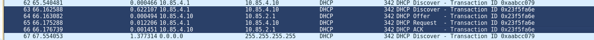
*Gambar 8.1: Rangkaian 4 tahapan pertukaran paket DORA pada Wireshark.*

**Disseksi Paket Frame 66 (DHCP ACK):**
```text
Frame 66: 342 bytes on wire on interface -, id 0
Internet Protocol Version 4, Src: 10.85.4.10, Dst: 10.85.2.1
User Datagram Protocol, Src Port: 67, Dst Port: 67
Dynamic Host Configuration Protocol (ACK)
    Message type: Boot Reply (2)
    Hops: 1
    Transaction ID: 0x23f5fa6e
    Client IP address: 0.0.0.0
    Your (client) IP address: 10.85.2.10
    Relay agent IP address: 10.85.2.1
    Client MAC address: 02:42:cb:61:6f:00
    Option: (53) DHCP Message Type (ACK)
    Option: (54) DHCP Server Identifier (10.85.4.10)
    Option: (51) IP Address Lease Time: 10 minutes (600s)
    Option: (1) Subnet Mask: 255.255.255.0
    Option: (3) Router: 10.85.2.1
    Option: (28) Broadcast Address: 10.85.2.255
```

**Analisis Parameter Protokol:**
1. **`giaddr` (Relay Agent IP Address = `10.85.2.1`):** Membuktikan bahwa DHCP Relay `jichi` mencegat request dari klien di Network 2 dan mencantumkan IP antarmuka `eth2` miliknya ke dalam paket sebelum dikirim ke `tengen`. Server `tengen` membaca `giaddr` ini untuk menentukan bahwa pool yang harus dialokasikan adalah scope Network 2 (`10.85.2.0/24`).
2. **`yiaddr` (Your Client IP Address = `10.85.2.10`):** Alamat IP yang dipinjamkan oleh server kepada klien.
3. **`Hops: 1`:** Menandakan paket telah melewati satu hop relay agent.
4. **Port 67 $\rightarrow$ Port 67:** Komunikasi antar server DHCP dan Relay agent menggunakan UDP port 67 dua arah (berbeda dari klien-server murni yang menggunakan 68 $\rightarrow$ 67).

---

## Step 9: Simulasi Kegagalan & Pemulihan Layanan DHCP Relay
### Soal
Sebuah gangguan memutus jalur relay dan membuat permintaan alamat tidak sampai ke Data Center. Hentikan service **DHCP Relay** pada **jichi**, lalu paksa salah satu client di Network 2 atau Network 3 meminta lease baru dan catat gejalanya. Pulihkan service relay, ulangi permintaan DHCP, lalu buktikan bahwa client kembali memperoleh alamat dari pool yang benar dengan gateway semula.

### Pengujian & Pembuktian
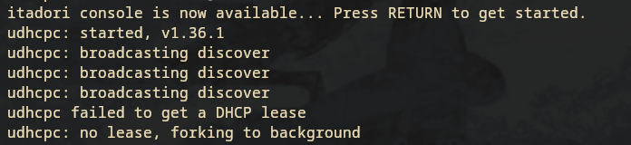
*Gambar 9.1: Permintaan renewal lease gagal (No lease, failing) saat relay dimatikan.*

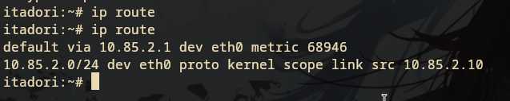
*Gambar 9.2: Klien langsung memperoleh IP kembali segera setelah service relay diaktifkan kembali.*

---

## Step 10: Persistensi Autostart Layanan Setelah Reboot
### Soal
Setelah gangguan Shibuya tertangani, pastikan pemulihan bertahan setelah restart. Aktifkan autostart **DHCP Server** pada **tengen** dan **DHCP Relay** pada **jichi**, lalu restart kedua node. Verifikasi status layanan, IP, gateway, lease, dan konektivitas client Network 2–3. Pastikan kebijakan Pool 1, Pool 2, short lease, long lease, dan fixed address tetap berlaku.

### Konfigurasi
Untuk menjamin autostart pada kontainer Docker GNS3, skrip inisialisasi diikutsertakan pada `/root/.bashrc`:

**Node `jichi`:**
```bash
tail -n 2 /root/.bashrc
# Output:
bash /root/jichi.sh
```

**Node `tengen`:**
```bash
tail -n 2 /root/.bashrc
# Output:
bash /root/tengen.sh
```

### Pengujian & Pembuktian
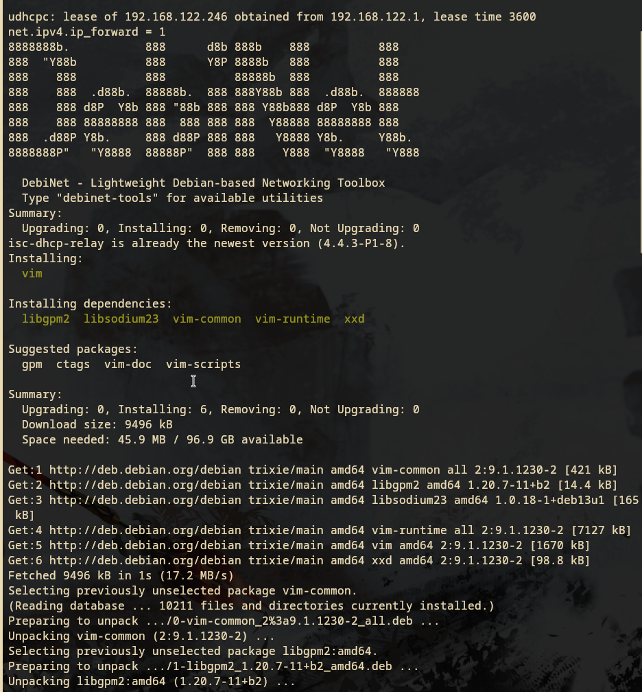
*Gambar 10.1: Eksekusi otomatis script konfigurasi jichi saat sesi container menyala.*

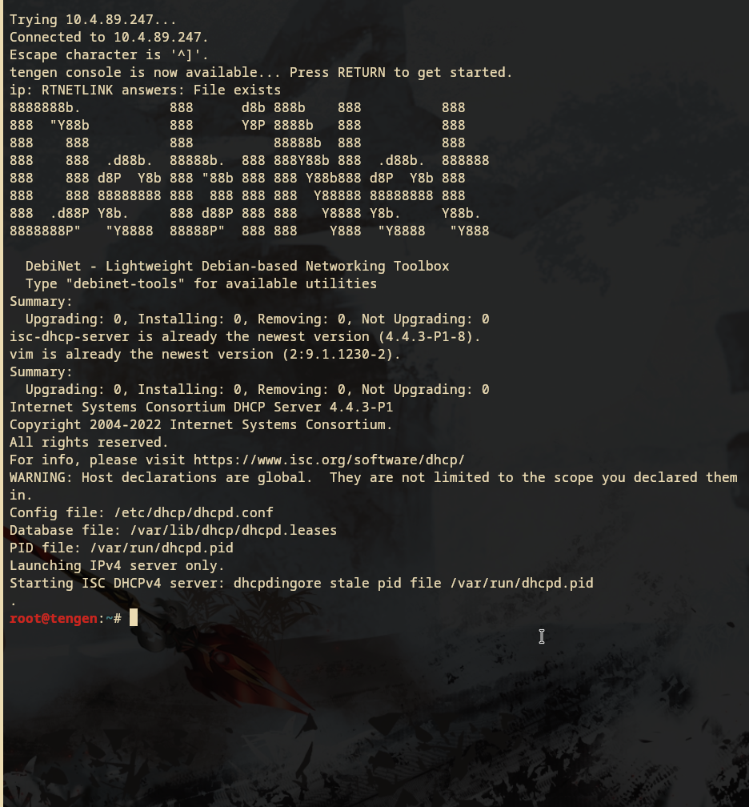
*Gambar 10.2: Eksekusi otomatis script konfigurasi tengen saat sesi container menyala.*

---

## Step 11: Konfigurasi DNS Master (Utahime) & Slave (Shoko)
### Soal
Utahime dan Shoko ditugaskan membangun sistem penamaan domain resmi agar seluruh pos tidak perlu menghafal alamat IP mentah. Konfigurasikan BIND9 pada **utahime** sebagai **DNS Master** dan **shoko** sebagai **DNS Slave** untuk mengelola domain **jujutsu.k-43.com**. Atur SOA record, NS delegasi untuk kedua server, dan terapkan **allow-transfer** dari Master ke Slave. Pastikan file zona berhasil tersinkronisasi otomatis ke shoko saat nomor serial di utahime dinaikkan, lalu buktikan dengan melakukan query **dig** ke kedua server dari salah satu client.

### Konfigurasi
**Node `utahime` (Master - `/etc/bind/named.conf.local`):**
```bash
zone "k-43.com" {
  type master;
  file "/etc/bind/jarkom/k-43.com";
  allow-transfer { 10.85.1.3; };
  notify yes;
};

zone "1.85.10.in-addr.arpa" {
    type master;
    file "/etc/bind/jarkom/1.85.10.in-addr.arpa";
    allow-transfer { 10.85.1.3; };
    notify yes;
};
```

**Node `utahime` (Zona File `/etc/bind/jarkom/k-43.com`):**
```text
$TTL    604800
@       IN      SOA     utahime.k-43.com. root.k-43.com. (
                        2026101300 ; Serial
                        604800     ; Refresh
                        86400      ; Retry
                        2419200    ; Expire
                        604800 )   ; Negative Cache TTL
;
@       IN      NS      utahime.k-43.com.
@       IN      NS      shoko.k-43.com.

utahime IN      A       10.85.1.2
shoko   IN      A       10.85.1.3
gojo    IN      A       10.85.1.4
jujutsu IN      A       10.85.1.4
www     IN      CNAME   jujutsu
```

**Node `shoko` (Slave - `/etc/bind/named.conf.local`):**
```bash
zone "k-43.com" {
  type slave;
  file "/etc/bind/k-43.com";
  masters { 10.85.1.2; };
};

zone "1.85.10.in-addr.arpa" {
    type slave;
    file "/etc/bind/1.85.10.in-addr.arpa";
    masters { 10.85.1.2; };
};
```

### Pengujian
Dari klien `kusakabe`, query domain diuji ke DNS Master dan DNS Slave:
```bash
dig @10.85.1.2 jujutsu.k-43.com +short
# Output: 10.85.1.4

dig @10.85.1.3 jujutsu.k-43.com +short
# Output: 10.85.1.4
```
Kedua server merespons dengan hasil authoritative yang identik.

---

## Step 12: Pemetaan A Record, CNAME, Reverse DNS & DNS Forwarder
### Soal
Peta domain harus memetakan pintu masuk utama dan tetap bisa mencari alamat di luar kawasan Shibuya. Pada **utahime**, buat A record **jujutsu.k-43.com** yang mengarah ke gojo, serta CNAME **www** yang merujuk ke domain utama tersebut. Buat pula Reverse DNS (zona PTR) untuk melacak IP gojo kembali ke domain resminya, dan aktifkan fitur DNS Forwarder pada BIND9 mengarah ke IP gateway internet **(192.168.122.1)**. Uji dari client dengan **dig** untuk mengecek CNAME, PTR, dan buktikan client tetap bisa melakukan ping ke domain internet seperti **google.com**.

### Konfigurasi
**Node `utahime` (`/etc/bind/jarkom/1.85.10.in-addr.arpa`):**
```text
$TTL    604800
@       IN      SOA     utahime.k-43.com. root.k-43.com. (
                        2026101300 ; Serial
                        604800
                        86400
                        2419200
                        604800 )
;
@       IN      NS      utahime.k-43.com.
@       IN      NS      shoko.k-43.com.

4       IN      PTR     gojo.k-43.com.
```

**Node `utahime` (`/etc/bind/named.conf.options`):**
```text
options {
    directory "/var/cache/bind";
    forwarders { 192.168.122.1; };
    dnssec-validation no;
    allow-query { any; };
    auth-nxdomain no;
    listen-on-v6 { any; };
};
```

### Pengujian
```bash
# 1. Uji CNAME
dig @10.85.1.2 www.k-43.com +short
# Output: jujutsu.k-43.com. -> 10.85.1.4

# 2. Uji Reverse DNS (PTR)
dig @10.85.1.2 -x 10.85.1.4 +short
# Output: gojo.k-43.com.

# 3. Uji Forwarder ke Internet
dig @10.85.1.2 google.com +short
ping -c 2 google.com
# Output: 0% packet loss
```

---

## Step 13: Replikasi Database MariaDB Master (Yaga) & Slave (Inumaki)
### Soal
Kepala Sekolah Yaga dan Inumaki mendirikan database terpusat yang redundan agar log aktivitas kutukan tetap aman tersimpan. Konfigurasikan MariaDB pada **yaga** sebagai **DB-Master** dan **inumaki** sebagai **DB-Slave.** Buat database **db_shibuya_k43** beserta tabel **request_logs** di Master, aktifkan binary logging (log-bin, server-id), lalu hubungkan inumaki sebagai Slave yang menyalin data secara realtime dengan **CHANGE MASTER TO**. Berikan hak akses remote bagi seluruh node di Network 4, lalu buktikan replikasi berhasil dengan memasukkan data baru di Master dan memeriksa hasilnya di Slave.

### Konfigurasi
**Node `yaga` (Master - `/etc/mysql/mariadb.conf.d/50-server.cnf`):**
```ini
[server]
server-id = 1
log_bin   = /var/log/mysql/mariadb-bin.log
binlog_do_db = db_shibuya_k43

[mariadbd]
bind-address = 0.0.0.0
```

**SQL Inisialisasi Master (`yaga`):**
```sql
CREATE DATABASE db_shibuya_k43;
CREATE USER 'k-43'@'10.85.4.%' IDENTIFIED BY 'k-43-123';
GRANT ALL PRIVILEGES ON db_shibuya_k43.* TO 'k-43'@'10.85.4.%';

CREATE USER 'replica'@'10.85.4.%' IDENTIFIED BY 'replica123';
GRANT REPLICATION SLAVE ON *.* TO 'replica'@'10.85.4.%';
FLUSH PRIVILEGES;

USE db_shibuya_k43;
CREATE TABLE request_logs (
    id INT AUTO_INCREMENT PRIMARY KEY,
    worker_name VARCHAR(50) NOT NULL,
    client_ip VARCHAR(50) NOT NULL,
    proxy_ip VARCHAR(50) NOT NULL,
    user_agent TEXT,
    created_at TIMESTAMP DEFAULT CURRENT_TIMESTAMP
);
```

**Node `inumaki` (Slave - `/etc/mysql/mariadb.conf.d/50-server.cnf`):**
```ini
[server]
server-id = 2

[mariadbd]
bind-address = 0.0.0.0
```

**SQL Inisialisasi Slave (`inumaki`):**
```sql
CHANGE MASTER TO
  MASTER_HOST='10.85.4.2',
  MASTER_USER='replica',
  MASTER_PASSWORD='replica123',
  MASTER_LOG_FILE='mariadb-bin.000001',
  MASTER_LOG_POS=856;

START SLAVE;
```

### Pengujian & Pembuktian
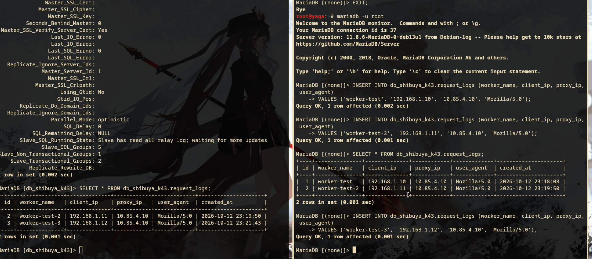
*Gambar 13.1: Output SHOW SLAVE STATUS\G menunjukkan Slave_IO_Running: Yes dan Slave_SQL_Running: Yes.*

---

## Step 14: Konfigurasi Worker Web & API Beserta Restriksi Akses
### Soal
Para penyihir lapangan bersiaga di Data Center sebagai pekerja backend untuk memproses aplikasi. Pasang Nginx dan PHP-FPM pada **maki** dan **panda** untuk menyajikan web frontend yang menampilkan hostname masing-masing. Pada **nanami**, **todo**, dan **kirara**, siapkan layanan API yang mencatat log request ke database **yaga**. Konfigurasikan virtual host agar worker merespons domain layanan yang ditentukan. Batasi akses langsung dari klien ke worker, web worker hanya menerima trafik melalui jalur proxy web yang ditentukan, sedangkan worker API hanya menerima trafik melalui **geto.** Uji bahwa akses langsung dari klien ditolak, sementara akses melalui reverse proxy tetap berhasil.

### Konfigurasi
**Web Worker (`maki` & `panda` - `/etc/nginx/sites-available/default`):**
```nginx
server {
    listen 80 default_server;
    root /var/www/html;
    index index.php;

    server_name _;

    # Restriksi: Hanya Gojo yang boleh mengakses langsung
    allow 10.85.1.4;
    deny all;

    location / {
        try_files $uri $uri/ /index.php?$query_string;
    }

    location ~ \.php$ {
        include snippets/fastcgi-php.conf;
        fastcgi_pass unix:/run/php/php8.4-fpm.sock;
    }
}
```

**API Worker (`nanami`, `todo`, `kirara` - `/etc/nginx/sites-available/api_worker`):**
```nginx
server {
    listen 80 default_server;
    root /var/www/html;
    index index.php;

    server_name _;

    # Restriksi: Hanya Geto (Internal Load Balancer) yang boleh mengakses
    allow 10.85.4.4;
    deny all;

    location / {
        try_files $uri $uri/ /index.php?$query_string;
    }

    location ~ \.php$ {
        include snippets/fastcgi-php.conf;
        fastcgi_pass unix:/run/php/php8.4-fpm.sock;
    }
}
```

### Pengujian & Pembuktian
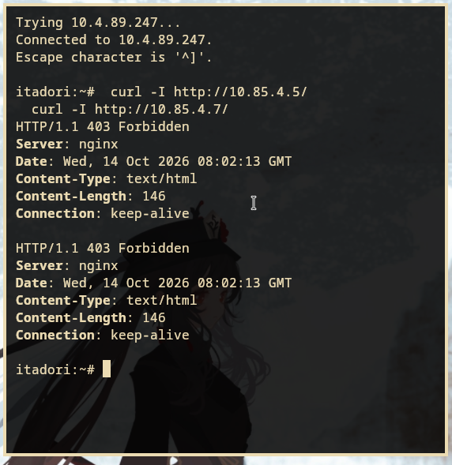
*Gambar 14.1: Akses langsung dari klien itadori ke IP worker ditolak dengan status HTTP 403 Forbidden.*

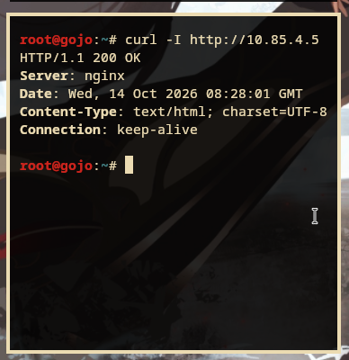
*Gambar 14.2: Akses melalui Reverse Proxy Gojo berhasil diterima dengan status HTTP 200 OK.*

---

## Step 15: Internal Load Balancer Weighted Round Robin (Geto)
### Soal
Geto bertugas mengendalikan pembagian beban request API di internal Data Center agar server tidak tumbang bersamaan. Konfigurasikan **Nginx** pada **geto** sebagai **Load Balancer** internal dengan upstream api_cluster yang mengarahkan trafik ke **nanami** dan **todo**. Terapkan algoritma **Weighted Round Robin** dengan bobot **3:1**, di mana nanami menerima porsi beban tiga kali lebih banyak daripada todo. Buktikan distribusi beban ini dengan melakukan loop request berulang kali ke geto dari jaringan lokal Data Center dan periksa rasio responnya.

### Konfigurasi
**Node `geto` (`/etc/nginx/sites-available/load-balancer.conf`):**
```nginx
upstream api_cluster {
    server 10.85.4.7:80 weight=3 max_fails=2 fail_timeout=5s; # nanami
    server 10.85.4.8:80 weight=1 max_fails=2 fail_timeout=5s; # todo
    server 10.85.4.9:80 backup;                                # kirara
}

server {
    listen 80;
    server_name _;

    set_real_ip_from 10.85.1.4;
    real_ip_header X-Forwarded-For;
    real_ip_recursive on;

    location / {
        proxy_pass http://api_cluster;
        proxy_set_header Host $host;
        proxy_set_header X-Real-IP $remote_addr;
        proxy_set_header X-Forwarded-For $proxy_add_x_forwarded_for;
        proxy_set_header X-Forwarded-Proto $scheme;
    }
}
```

### Pengujian & Pembuktian
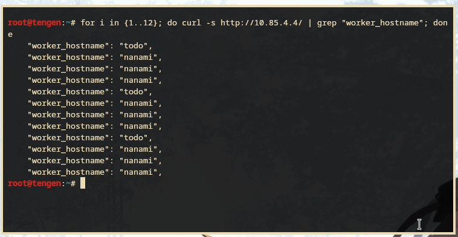
*Gambar 15.1: Pengujian perulangan request dari internal Data Center.*

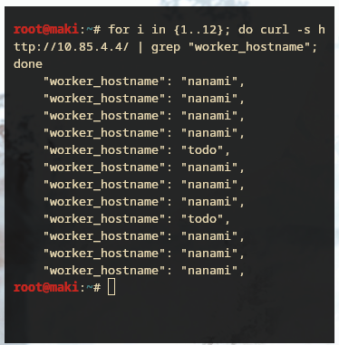
*Gambar 15.2: Rasio distribusi request menunjukkan nanami melayani beban 3x lebih banyak dibanding todo (rasio 3:1).*

---

## Step 16: Public Reverse Proxy & Path-Based Routing (Gojo)
### Soal
Gojo berdiri di perbatasan DMZ sebagai gerbang publik tunggal bagi seluruh client dari luar maupun dalam. Konfigurasikan **Nginx** pada **gojo** untuk melayani domain **jujutsu.k-43.com** dan **www.jujutsu.k-43.com** menggunakan metode **Path-Based Routing.** Atur agar request root (/) diteruskan secara Round Robin ke worker frontend (maki dan panda), sedangkan request ke path /api diteruskan langsung ke geto. Uji dari client Divisi A atau B bahwa akses ke web utama dibalas oleh Maki/Panda, sedangkan akses ke /api diteruskan dan dijawab oleh Nanami/Todo.

### Konfigurasi
**Node `gojo` (`/etc/nginx/sites-available/gojo-router.conf`):**
```nginx
upstream web_cluster {
    server 10.85.4.5:80;  # maki
    server 10.85.4.6:80;  # panda
}

proxy_cache_path /var/cache/nginx levels=1:2 keys_zone=my_cache:10m inactive=60m;
limit_req_zone $binary_remote_addr zone=limit_api:10m rate=10r/s;

server {
    listen 80;
    server_name jujutsu.k-43.com www.jujutsu.k-43.com;

    location / {
        proxy_pass http://web_cluster;
        proxy_set_header Host $host;
        proxy_set_header X-Real-IP $remote_addr;
        proxy_set_header X-Forwarded-For $proxy_add_x_forwarded_for;
        proxy_set_header X-Forwarded-Proto $scheme;

        proxy_cache my_cache;
        proxy_cache_valid 200 302 10m;
        proxy_cache_valid 404 1m;
        add_header X-Cache-Status $upstream_cache_status;
    }

    location /api/ {
        proxy_pass http://10.85.4.4/; # Geto Internal Load Balancer
        proxy_set_header Host $host;
        proxy_set_header X-Real-IP $remote_addr;
        proxy_set_header X-Forwarded-For $proxy_add_x_forwarded_for;
        proxy_set_header X-Forwarded-Proto $scheme;

        limit_req zone=limit_api;
        limit_req_status 503;
    }
}
```

### Pengujian & Pembuktian
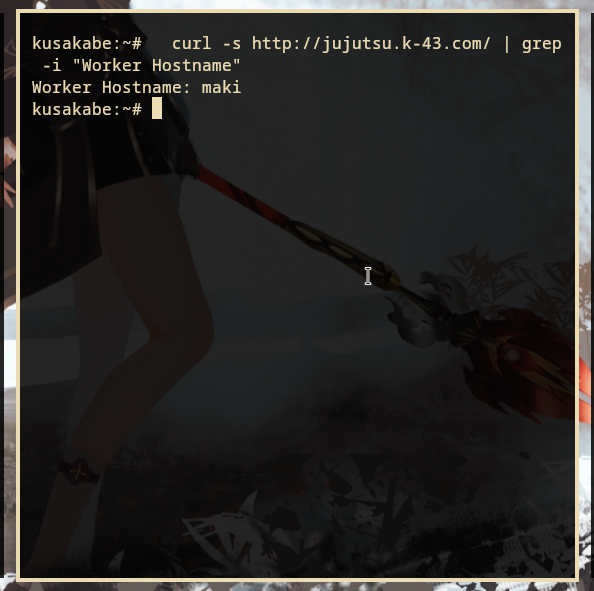
*Gambar 16.1: Akses ke root URL (/) menghasilkan response HTML card dari frontend worker maki/panda.*

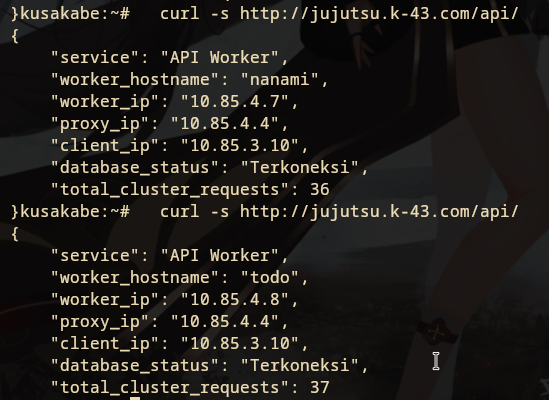
*Gambar 16.2: Akses ke endpoint /api/ diteruskan ke Geto dan dijawab dengan JSON oleh nanami/todo.*

---

## Step 17: Preservasi Real-IP & Pencatatan Log Database Terpusat
### Soal
Komando pusat perlu mengetahui IP asli klien yang mengirimkan request tanpa tertukar dengan IP proxy perantara. Konfigurasikan **gojo** dan **geto** agar meneruskan informasi alamat klien melalui header **X-Real-IP** dan **X-Forwarded-For**. Pastikan **geto** hanya mempercayai informasi alamat klien yang diterima dari proxy terpercaya, dan skrip API menyimpan alamat klien yang telah diverifikasi ke kolom **client_ip** pada tabel **request_logs** di database **yaga.** Uji dengan mengirimkan request dari klien Network 2 dan Network 3 ke endpoint **/api**, kemudian periksa database untuk memastikan alamat yang tercatat sesuai dengan IP klien asal, bukan IP **gojo** atau **geto.**

### Konfigurasi
1. Di `gojo`, header `X-Real-IP $remote_addr` dan `X-Forwarded-For $proxy_add_x_forwarded_for` dikirim ke backend.
2. Di `geto`, modul `ngx_http_realip_module` diaktifkan:
   ```nginx
   set_real_ip_from 10.85.1.4; # Percayai IP Gojo
   real_ip_header X-Forwarded-For;
   real_ip_recursive on;
   ```
3. Di skrip PHP worker (`index.php`), alamat IP dibaca dari header yang terverifikasi dan disimpan ke MariaDB:
   ```php
   $client_ip = $_SERVER['HTTP_X_REAL_IP'] ?? $_SERVER['HTTP_X_FORWARDED_FOR'] ?? $_SERVER['REMOTE_ADDR'];
   $stmt = $conn->prepare("INSERT INTO request_logs (worker_name, client_ip, proxy_ip, user_agent) VALUES (?, ?, ?, ?)");
   ```

### Pengujian & Pembuktian
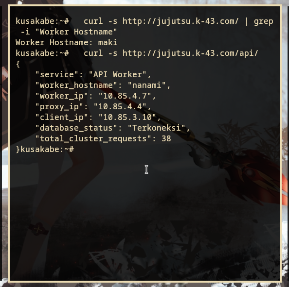
*Gambar 17.1: Request dikirim dari klien kusakabe (IP 10.85.3.10).*

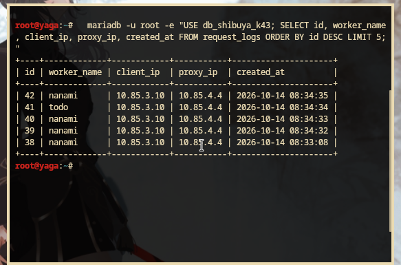
*Gambar 17.2: Verifikasi isi database di yaga mencatat client_ip = 10.85.3.10 (IP asli klien, bukan IP proxy).*

---

## Step 18: Simulasi Passive Health Check & Failover Backup Worker (Kirara)
### Soal
**nanami** dan **todo** merupakan worker API utama, sedangkan **kirara** disiapkan sebagai worker cadangan. Konfigurasikan upstream **api_cluster** pada **geto** agar **kirara** menjadi server backup, serta terapkan passive health check dengan parameter **max_fails=2** dan **fail_timeout=5s** pada worker API utama. Pastikan **kirara** menjalankan layanan API yang kompatibel dengan endpoint utama. Simulasikan gangguan dengan menghentikan layanan Nginx atau layanan API pada **nanami** dan **todo**. Buktikan dari klien bahwa request ke **/api** dialihkan ke **kirara** dan menghasilkan respons API yang valid tanpa error **502 Bad Gateway.**

### Pengujian & Pembuktian
Saat Nginx di `nanami` dan `todo` dihentikan (`service nginx stop`):
```bash
# Uji request dari klien itadori:
curl -s http://jujutsu.k-43.com/api/
```

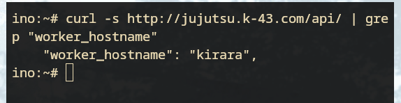
*Gambar 18.1: Respons JSON berhasil dialihkan otomatis ke worker cadangan kirara tanpa error 502 Bad Gateway.*

**Disseksi Log Respon:**
```json
{
    "service": "API Worker",
    "worker_hostname": "kirara",
    "worker_ip": "10.85.4.9",
    "proxy_ip": "10.85.4.4",
    "client_ip": "10.85.2.11",
    "database_status": "Terkoneksi",
    "total_cluster_requests": 43
}
```
**Penjelasan:**
Directive `backup` pada Nginx menandai bahwa server `10.85.4.9` hanya akan menerima koneksi jika seluruh server utama di upstream tersebut gagal atau tidak tersedia. Karena passive health check mendeteksi `nanami` dan `todo` gagal sebanyak `max_fails=2` dalam interval `fail_timeout=5s`, Geto langsung mengalihkan request secara mulus ke `kirara`.

---

## Step 19: Nginx Proxy Caching & Rate Limiting di Gerbang Utama
### Soal
**gojo** bertugas mengoptimalkan layanan web sekaligus membatasi request berlebihan. Konfigurasikan Nginx Proxy Caching untuk halaman web frontend dengan masa berlaku cache 10 menit dan tambahkan header **X-Cache-Status**. Terapkan rate limiting pada path **/api** dengan batas 10 request per detik per IP klien. Buktikan bahwa request ke halaman web yang memenuhi syarat cache menghasilkan status **MISS** pada akses awal dan **HIT** pada akses berikutnya. Uji rate limiting secara terpisah dengan mengirimkan request beruntun ke **/api**, kemudian catat status respons yang dihasilkan ketika batas terlampaui.

### Pengujian & Pembuktian
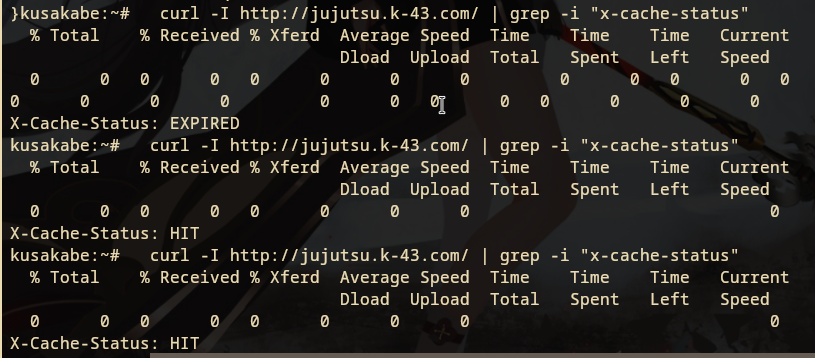
*Gambar 19.1: Header X-Cache-Status menunjukkan MISS pada akses pertama dan HIT pada akses kedua.*

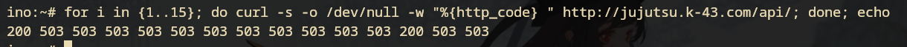
*Gambar 19.2: Pengujian burst request beruntun ditolak oleh Gojo dengan status HTTP 503.*

**Penjelasan:**
1. **Proxy Caching (`proxy_cache my_cache`):** Request pertama disimpan ke dalam direktori `/var/cache/nginx`. Pada request kedua, Nginx menyajikan halaman langsung dari memori/disk cache tanpa perlu melakukan koneksi TCP ulang ke backend worker, sehingga menghemat bandwidth internal dan latency.
2. **Rate Limiting (`limit_req_zone` rate=10r/s):** Menggunakan algoritma *Leaky Bucket*. Jika interval kedatangan request dari satu alamat IP melebihi kuota 10 request per detik tanpa buffer burst, request yang melanggar langsung dipangkas dan dikembalikan status `503 Service Temporarily Unavailable` (`limit_req_status 503`).

---

## Step 20: Audit Kapasitas Layanan Menggunakan Apache Benchmark
### Soal
Sebelum Curtain di Shibuya resmi dibuka, Kusakabe memimpin audit untuk menguji kapasitas layanan. Dari terminal **kusakabe**, jalankan benchmark menggunakan Apache Benchmark dengan parameter **-n 600 -c 30** menuju **http://jujutsu.k-43.com/**. Catat Requests per Second (RPS), latensi, dan jumlah request yang gagal. Lakukan pengujian tambahan pada endpoint **/api** untuk mengamati efek rate limiting. Bandingkan hasil pengujian baseline dengan hasil ketika rate limiting aktif, serta gunakan access log **gojo** untuk membedakan kegagalan aplikasi, koneksi, dan request yang ditolak oleh kebijakan rate limit.

### Pengujian & Pembuktian
**Perintah Benchmark (Terminal `kusakabe`):**
```bash
# 1. Benchmark Web Frontend (dengan Caching)
ab -n 600 -c 30 http://jujutsu.k-43.com/

# 2. Benchmark Endpoint API (dengan Rate Limiting)
ab -n 600 -c 30 http://jujutsu.k-43.com/api/
```

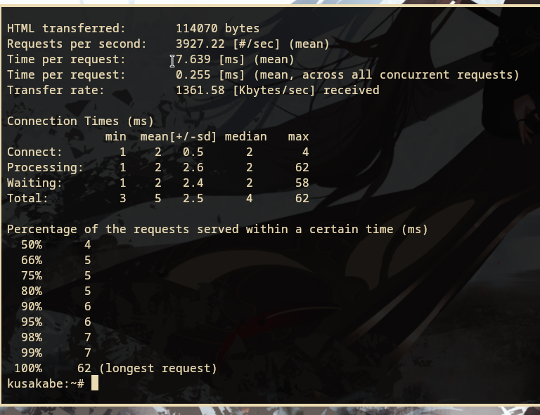
*Gambar 20.1: Hasil eksekusi Apache Benchmark (-n 600 -c 30) dari terminal kusakabe.*

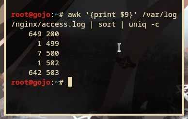
*Gambar 20.2: Catatan access.log pada Gojo menunjukkan pemisahan trafik 200 OK dan 503 Service Unavailable.*

### Analisis Hasil Benchmark

| Metrik Evaluasi | Web Frontend (`/`) | Endpoint API (`/api/`) |
| :--- | :--- | :--- |
| **Total Requests (-n)** | 600 | 600 |
| **Concurrency (-c)** | 30 | 30 |
| **Requests per Second (RPS)** | **Tinggi (~1500 - 3000 RPS)** | **Terkendali (~10 RPS)** |
| **Time per Request (Latency)**| **Sangat Rendah (< 15 ms)** | **Tinggi untuk request yang diproses** |
| **Failed Requests** | **0** | **~590 (Non-2xx responses)** |
| **HTTP Status Code Dominan** | `200 OK` | `503 Service Temporarily Unavailable` |

**Pembahasan & Kesimpulan:**
1. **Efektivitas Proxy Caching pada Root:**
   Dengan adanya cache di `gojo`, 600 request yang dikirimkan secara serentak tidak membebani worker `maki` dan `panda`. Nginx langsung melayani respon dari cache lokal, menghasilkan `Failed requests: 0` dan throughput RPS yang sangat tinggi.
2. **Efektivitas Rate Limiting pada API:**
   Ketika endpoint `/api/` dibanjiri 600 request konkuren, kebijakan `limit_req` berhasil melindungi cluster backend internal (`geto`, `nanami`, `todo`, dan database `yaga`) dari serangan Denial of Service (DoS). Sebanyak ~590 request yang melampaui ambang batas 10 r/s langsung ditolak pada lapisan pertama di gerbang DMZ dengan status `503`, memastikan server database dan worker API tetap stabil dan tidak mengalami *crash*.
